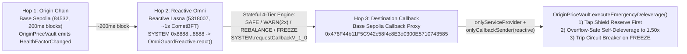

# OmniGuard Sentinel — Sub-Second Cross-Chain Liquidation Shield & Automated Circuit Breaker

> **Reactive Omni Buildathon Entry** (`Every Second Counts` — Base Sepolia `84532` ↔ Reactive Lasna `5318007`)  
> **Live Telemetry & Interactive Simulator:** https://lhortl.github.io/reactive-omni-sentinel/  
> **Repository:** https://github.com/LHorTL/reactive-omni-sentinel  
> Built natively against **Reactive Omni v2** (`reactive-lib-omni`, System Contract `0x8888...8888`, `SYSTEM.requestCallbackV_1_0`, and Base Sepolia Omni Callback Proxy `0x476F44b11F5C942c58f4c8E3d0300E5710743585`).

---

## Why OmniGuard?

Base Sepolia produces **200ms blocks (~5 blocks/sec)**. During sharp market drawdowns, legacy off-chain keeper bots and ~7-second consensus relays arrive *after* MEV liquidators have already seized user collateral.

**OmniGuard** eliminates off-chain keepers entirely by pairing:
1. **`OriginPriceVault.sol` (Base Sepolia `84532`)** — A lending/treasury vault emitting `HealthFactorChanged(user, healthBps, collateral, debt, timestamp)` and executing authenticated, overflow-safe deleveraging + circuit breaking via `executeEmergencyDeleverage(...)`.
2. **`OmniGuardReactive.sol` (Reactive Lasna `5318007`)** — A stateful **Reactive Omni** contract subscribed to `HealthFactorChanged` through `SYSTEM` (`0x8888888888888888888888888888888888888888`), executing a genuine **4-tier escalation state machine** (`SAFE` → `WARN` → `REBALANCE` → `EMERGENCY_FREEZE`) in **~1s CometBFT finality** and dispatching `SYSTEM.requestCallbackV_1_0(...)` back to Base Sepolia (or cross-chain to Unichain Sepolia `1301`).
3. **Interactive Telemetry & Control dApp (`web/`)** — Live 3-hop finality visualizer (`~1.0s` Omni vs `~7.4s` legacy), MetaMask/EIP-1193 Base Sepolia + Lasna wallet switcher, on-chain RPC inspector, and a 10-second interactive stress-test deck matching exact Solidity invariants.

---

## Architecture (3-Hop Reactive Omni Loop)



---

## Built Natively for Reactive Omni v2 (Zero Deprecated Legacy APIs)

Live RPC bytecode verification against `dev.reactive.network` confirmed that Reactive Omni upgraded both the system contract and testnet callback proxies:

| Network | Chain ID | Role | Verified Live Contract Address |
| :--- | :--- | :--- | :--- |
| **Reactive Lasna (Omni)** | `5318007` (`0x512577`) | System Contract (`SYSTEM`) | `0x8888888888888888888888888888888888888888` |
| **Base Sepolia** | `84532` (`0x14a34`) | Omni Callback Proxy | `0x476F44b11F5C942c58f4c8E3d0300E5710743585` |
| **Unichain Sepolia** | `1301` (`0x515`) | Omni Callback Proxy (Cross-Chain Ready) | `0x775c9B990ADe401060B78D0e98684eEf8d2466C1` |
| **Ethereum Sepolia** | `11155111` (`0xaa36a7`) | Omni Callback Proxy | `0xAa14d9Cd0f788Ca23d11805986C1d8bd035D23b4` |
| **Base Sepolia** | `84532` | Official `ReactiveFaucetL1` Bridge (`1 ETH → 100 lREACT`) | `0x2afaFD298b23b62760711756088F75B7409f5967` |

### Key Reactive Omni Engineering Decisions
- **100% `block.timestamp` Cooldowns (NEVER `block.number`)**: Base Sepolia produces 5 blocks/sec (200ms). Both `OmniGuardReactive` (`rebalanceCooldownSeconds = 15`, `emergencyCooldownSeconds = 300` repeat-freeze suppression window, `escalationWindowSeconds = 60`) and `OriginPriceVault` (`vaultCooldownSeconds = 15`, `maxCallbackDelaySeconds = 300`, rate-limited authenticated `checkAndEmitHealthFactor`) strictly use wall-clock timestamps — verified by mining 100 rapid blocks in tests!
- **Stateful Multi-Tier Escalation (Not a Trivial Pass-Through)**:
  - `SAFE` (`>= 1.35x`): Resets warning streak, 0 callbacks.
  - `WARN` (`1.20x – 1.35x`): Tracks per-user consecutive warning streak inside a 60s window; 1st warning emits alert without spending destination gas; 2nd consecutive warning auto-escalates to `REBALANCE`.
  - `REBALANCE` (`1.08x – 1.20x`): Enforces 15s wall-clock cooldown, increments monotonic per-user nonce, dispatches `requestCallbackV_1_0` restoring exact `1.50x` health factor (tapping Shield Reserve first before selling collateral via overflow-safe `x = D - (C - D) * 10000 / (T - 10000)`).
  - `EMERGENCY_FREEZE` (`< 1.08x`): **Immediately bypasses rebalance cooldown** on first escalation, executes maximum safe deleverage (even on underwater `HF < 1.00x` positions with zero underflow!), and freezes further borrows/withdrawals until recovery.
- **Dual Callback Authentication + CEI + Non-Reverting `react()`**:
  - `OriginPriceVault` enforces BOTH `onlyServiceProvider` (`msg.sender == CallbackProxy`) AND `onlyCallbackSender(reactiveSender)` (injected 1st arg == immutable `_CALLBACK_SENDER == address(OmniGuardReactive)`), plus `ReentrancyGuard`, `Pausable`, and strict monotonic nonces (`NonMonotonicNonce`).
  - `OmniGuardReactive.react()` reverts ONLY on unauthorized callers (`onlySystem`), while cleanly emitting `ReactionIgnored` / `CooldownSuppressed` on non-actionable logs so Lasna lREACT reserves are never wasted on reverting reactive transactions.
- **Official 2-Step Immutable Deployment Order**:
  1. Deploy `OmniGuardReactive` on Lasna (`5318007`) first.
  2. Deploy `OriginPriceVault` on Base Sepolia (`84532`) binding immutable `_CALLBACK_SENDER = address(OmniGuardReactive)`.
  3. Call `OmniGuardReactive.configureVaultAndSubscribe(originVault, originVault)` on Lasna to activate `SYSTEM.subscribe(...)`.

---

## Quick Start & Verification

### 1. Install, Compile & Run Full Security Suite (31/31 Tests)
```bash
npm install
npm run compile
npm test
npm run deploy:local
```

**Test Suite Coverage (`test/OmniGuard.test.js` — 31 passing tests):**
- **Deployment & Subscription Lifecycle (4 tests)**: `hardhat_setCode` installs `MockOmniSystemContract` at exact `0x8888...8888`, verifying immutable `_CALLBACK_SENDER`, exact `SYSTEM.subscribe` criteria, constructor guards, and owner-only unsubscribe/re-subscribe.
- **End-to-End 3-Hop Loop (5 tests)**: Shield-only rebalance (0 ETH sold), hybrid shield + exact self-deleverage math, full `SAFE → WARN(1) → WARN(2)→REBALANCE → EMERGENCY_FREEZE` escalation, circuit-breaker freeze/recovery, and cross-chain Base Sepolia → Unichain Sepolia (`1301`) routing.
- **Base Sepolia 200ms Safety (4 tests)**: 100-block rapid burst cooldown immunity test, independent on-chain `vaultCooldownSeconds`, stale/future timestamp rejection, and out-of-order stale log suppression.
- **Adversarial Security & Auth (8 tests)**: Unauthorized direct callback (`NotAuthorized`), spoofed reactive sender via valid proxy (`CallbackNotAuthorized`), spoofed `react()` caller (`NotAuthorized`), replay & zero-nonce rejection (`NonMonotonicNonce`), malicious proxy reentrancy attack during `coverDebt()` (`ReentrancyGuard`), non-reverting `react()` gas safety, invalid tier/target/duplicate-freeze guards, and Reactive `pay()`/`coverDebt()` settlement.
- **Edge Cases, Anti-Drain, Governance & Gas Budget (10 tests)**: Underwater `<1.00x` crash without underflow, `$100M+` treasury overflow safety, zero-debt handling, oracle auth + 25-user batch DoS cap, already-frozen skip in `updateOraclePrice`/`openOrTopUpPosition`, authenticated wall-clock rate-limited `checkAndEmitHealthFactor` anti-spam guard, 300s repeat-freeze suppression + instant re-arm on `unfreezePosition`, guardian pause + native rescue, per-user risk isolation, and `<900,000` Reactive gas cap verification (`~205k` destination callback gas).

### 2. Build Web dApp & Run Playwright E2E Smoke Test
```bash
npm run web:install
npm run web:build
npm run e2e
```
Verified on **Desktop (`1440×900`)** and **Mobile (`390×844`)**: all 6 interactive scenarios pass with **0 console errors**, **0 page errors**, and **0 horizontal overflow**.

---

## Live Testnet Deployment & Verified 3-Hop Proof (Base Sepolia + Reactive Lasna)

**LIVE ON-CHAIN (`2026-11-25`)**: Both contracts are deployed, subscribed via `SYSTEM` (`0x8888...8888`), and verified end-to-end with a real cross-chain 3-hop `Origin -> Reactive -> Callback` deleverage transaction restoring position Health Factor to **`1.5000x`** in **`10.46s` wall-clock time** (`deployments/live.json` & `web/src/config/networks.js` synced):

### 1. Live Deployed Contracts & Subscription Receipts

| Chain | Contract / Action | Address / TX Hash | Explorer |
| :--- | :--- | :--- | :--- |
| **Reactive Lasna (`5318007`)** | `OmniGuardReactive` | `0xf9D56644f95b681a6Aa13AEE38dD406824dF71Ab` | [Deploy TX `0x300a...51c2`](https://lasna.reactscan.net/tx/0x300aa64841677c9768645acd39fe1e153a801f594ac415aaf27b091075a051c2) |
| **Base Sepolia (`84532`)** | `OriginPriceVault` | `0x841ADD49FC6291f205F4A8B0CBae3d85aCa3c379` | [Deploy TX `0xf4c3...ab33`](https://sepolia.basescan.org/tx/0xf4c3a625e8b53a875f67853f81257e586ceb1d5a680bbd695eb86ff483eaab33) |
| **Reactive Lasna (`5318007`)** | `configureVaultAndSubscribe()` | `SYSTEM.subscribe(84532, 0x841A...c379)` | [Subscribe TX `0x4cee...d4a5`](https://lasna.reactscan.net/tx/0x4cee795a8d0c33a826a9900c4f7a8adf887d34085557ac60fc2f6e625105d4a5) |

### 2. Verified Live 3-Hop Cross-Chain Execution Proof (`1.3888x -> 1.1666x -> 1.5000x`)

| Hop | Chain | Action & Outcome | Live Explorer TX |
| :--- | :--- | :--- | :--- |
| **Hop 1 (Origin)** | Base Sepolia (`84532`) | Oracle shock `$2,500 -> $2,100` (block `#63301302`), emitting `HealthFactorChanged` (`1.1666x` REBALANCE breach) | [`0x78c52c81...f6d725b`](https://sepolia.basescan.org/tx/0x78c52c81c02d8168734ec0dc970aacb70a93c828e226773c0231d76a8f6d725b) |
| **Hop 2 (Reactive)** | Reactive Lasna (`5318007`) | `OmniGuardReactive.react()` classifies `REBALANCE` and dispatches `SYSTEM.requestCallbackV_1_0` (`7,060 ms`) | [`0x47d83025...aee20d0b`](https://lasna.reactscan.net/tx/0x47d830253656b87d2d850ee98b756386a39b24e0f8bb123e23263b0baee20d0b) |
| **Hop 3 (Callback)** | Base Sepolia (`84532`) | CallbackProxy (`0x476F...3585`) invokes `executeEmergencyDeleverage()` -> **Restored Health Factor: `1.5000x`** (`10,459 ms` total) | [`0x1c860136...080dd979`](https://sepolia.basescan.org/tx/0x1c860136825923e7bef76537b8fb9da22b94ab7102269f9b524349a2080dd979) |

### Reproducing / Redeploying From Scratch
1. Generate a git-ignored deployer wallet (`.env`, zero key printing): `npm run wallet:new`
2. Bridge Base Sepolia ETH -> Lasna `lREACT` via `ReactiveFaucetL1` (`0x2afaFD298b23b62760711756088F75B7409f5967`): `npm run faucet:bridge`
3. Deploy both contracts & activate live Lasna subscription: `npm run deploy:live`
4. Execute & record a live 3-hop loop and verify status: `npm run trigger:live && npm run status:live`

---

## Project Structure

```text
reactive-omni-sentinel/
├── contracts/
│   ├── OriginPriceVault.sol          # Base Sepolia vault + authenticated callback executor
│   ├── OmniGuardReactive.sol         # Reactive Lasna stateful 4-tier escalation sentinel
│   ├── reactive-lib/                 # Vendored official Reactive-Network/reactive-lib-omni v2
│   └── mocks/                        # Exact 0x8888...8888 SystemContract, CallbackProxy & Reentrancy mocks
├── test/
│   └── OmniGuard.test.js             # 31 unit, integration & adversarial security tests
├── scripts/
│   ├── deploy-local.js               # Local 3-hop Hardhat proof
│   ├── generate-deployer.mjs         # Safe .env deployer generator (zero key printing)
│   ├── bridge-lreact.mjs             # Automated Base Sepolia ETH -> Lasna lREACT bridge
│   ├── deploy-live.mjs               # 3-step Base Sepolia + Lasna Omni deployment
│   ├── trigger-live-loop.mjs         # Live 3-hop TX trigger & explorer hash recorder
│   ├── check-live-status.mjs         # Live RPC, bytecode & balance telemetry CLI
│   └── e2e_smoke.py                  # Playwright Desktop + Mobile E2E verifier
├── web/                              # Vite + React interactive telemetry & wallet dApp (GH Pages ready)
├── .github/workflows/deploy-pages.yml
├── hardhat.config.js
├── .env.example
└── .gitignore
```

## License

MIT
